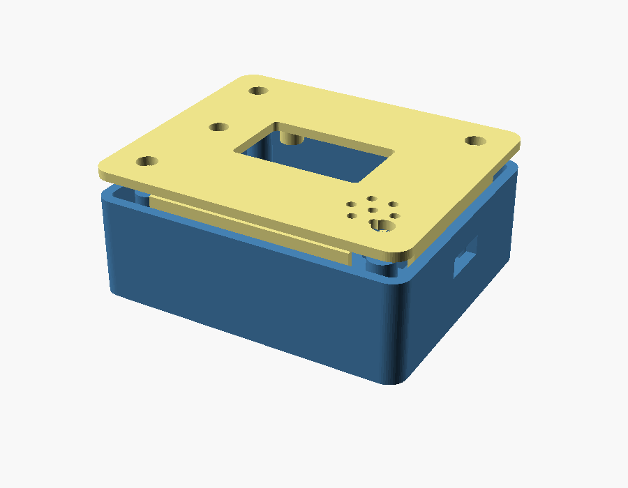

# 휴대용 하우징 (3D 프린터)

Seeed XIAO ESP32S3 + 0.96" OLED + LiPo 배터리를 담는 2분할 케이스입니다. 바닥 트레이와 뚜껑을 네 모서리 M2 나사로 조립합니다. 크기는 약 **58 × 48 × 21 mm** (성냥갑 정도).



## 파일

| 파일 | 설명 |
|---|---|
| `housing.scad` | 파라메트릭 원본. 부품 치수가 다르면 상단 숫자만 고치면 전체가 다시 맞춰집니다 |
| `base.stl` | 바닥 트레이 |
| `lid.stl` | 뚜껑 (화면 창이 바닥으로 가도록 이미 뒤집혀 있음) |

치수를 바꿨으면 STL을 다시 뽑으세요:
```bash
openscad -o base.stl -D 'part="base"' housing.scad
openscad -o lid.stl  -D 'part="lid"'  housing.scad
# 간섭 확인:  -D 'part="ghost"' 로 열면 부품 외곽이 반투명으로 보입니다
```

## 들어가는 하드웨어 (BOM)

| # | 부품 | 규격 | 비고 |
|---|---|---|---|
| 1 | **MCU 보드** | **Seeed XIAO ESP32S3** | 21×17.5mm, LiPo 충전 내장, BLE5 확장광고/장거리 지원 |
| 2 | **화면** | **0.96" OLED 128×64, I2C, SSD1306** | 4핀(VCC/GND/SCL/SDA). 1.3"는 SH1106(`-DOLED_SH1106=1`) |
| 3 | **배터리** | **LiPo 3.7V 500mAh, 503040** | 40×30×5.5mm. 커넥터 JST 1.25 또는 패드 납땜 |
| 4 | 버튼 | 6×6mm 택트 스위치 | GPIO0(BOOT)과 GND에 연결 |
| 5 | 소리 | 3.3V 액티브 부저(또는 진동모터+NPN) | 선택 |
| 6 | 배터리 측정 | 100kΩ 저항 ×2 | 선택, 1/2 분압 |
| 7 | 전원 스위치 | 소형 슬라이드 스위치 | 배터리 + 선에 직렬 |
| 8 | 나사 | **M2 × 6mm 셀프탭(태핑) ×4** | 납작/접시머리 |
| 9 | 배선 | AWG30 단선 몇 가닥 | |

> 배터리 규격이 다르면 `housing.scad`의 `bat_l/bat_w/bat_h`만 고치면 칸 크기가 자동으로 바뀝니다. 더 큰 배터리(예: 603048)도 숫자만 바꾸면 됩니다.

## 조립 순서

1. 배터리를 바닥 칸에 넣고, 선을 전원 스위치를 거쳐 XIAO의 BAT+/BAT- 패드에 납땜합니다.
2. XIAO를 받침 레일 위에 놓고 USB-C가 옆면 구멍에 맞는지 확인합니다.
3. OLED를 뚜껑 안쪽 스탠드오프 4곳에 M1.6 나사(또는 소량 접착)로 고정하고, 화면이 창에 맞는지 봅니다.
4. 택트 스위치를 뚜껑 버튼 자리(안쪽 6.6mm)에 끼우고 GPIO0/GND로 배선합니다.
5. OLED(SDA→D4, SCL→D5), 부저(D2)를 배선합니다. (핀은 `../platformio.ini`의 `xiao_esp32s3` 환경 기준)
6. 뚜껑을 덮고 네 모서리에 M2 나사를 조입니다.

## 프린트 설정 (권장)

- 재료: PLA 또는 PETG
- 레이어: 0.2mm, 벽 3줄, 채움 20%
- **서포트: 불필요.** 뚜껑은 화면 창이 바닥을 향하게 뒤집어 두었고, 바닥 트레이는 USB 구멍만 약간 브리지됩니다.
- 바닥 트레이는 열린 면이 위로, 뚜껑은 평평한 윗면이 바닥으로 놓고 인쇄합니다.

## 핀 요약 (XIAO ESP32S3)

| 신호 | XIAO 핀 | GPIO |
|---|---|---|
| OLED SDA | D4 | 5 |
| OLED SCL | D5 | 6 |
| 부저 | D2 | 3 |
| 버튼 | BOOT 또는 GPIO0 | 0 |
| 배터리 ADC | A0 | 1 |

## 끈/목걸이

뚜껑 모서리 라운드 옆에 끈 구멍이 필요하면 `housing.scad`에 말씀해 주세요. 러그(lug)를 추가해 드리겠습니다.
