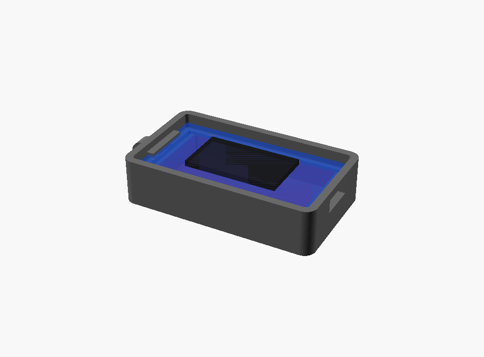

# 화면 일체형 보드용 하우징 (XIAO ESP32-S3 Plus 1.14")

화면·버튼·배터리 측정이 보드에 다 붙어 있는 **XIAO ESP32-S3 Plus(1.14" IPS)** 용 케이스입니다. 보드 위에 별도 OLED를 올리는 조립형(`housing.scad`)과 달리, 이 보드는 **화면·버튼 3개·USB가 보드에 통합**돼 있고 그 정확한 위치가 공개돼 있지 않습니다.

그래서 **앞면(윗면)을 통째로 열어 둔 "크래들(받침)" 구조**로 만들었습니다:
- 화면은 열린 윗면으로 그대로 보이고
- 버튼 3개도 윗면/옆면으로 눌리고
- USB-C는 옆 벽 슬롯으로 꽂힙니다
- 배터리는 보드 아래 칸에 들어갑니다

내부 부품 위치를 몰라도 되는 안전한 방식입니다.



## 파일
| 파일 | 설명 |
|---|---|
| `housing_plus.scad` | 파라메트릭 원본 |
| `plus_tray.stl` | 받침 본체 (이거 하나만 프린트하면 됩니다) |

```bash
openscad -o plus_tray.stl -D 'part="tray"' housing_plus.scad
# 보드/배터리 들어간 모습 확인:  -D 'part="preview"'
```

## 치수 (실측 후 맞추세요)
Seeed 위키 "Board Size **26 × 48 × 10.6 mm**" 기준으로 기본값을 넣었습니다. 보드를 받으면 실제로 재서 `housing_plus.scad` 위쪽 숫자를 맞추면 딱 맞습니다.

| 파라미터 | 뜻 | 기본값 |
|---|---|---|
| `board_l / board_w` | 보드 긴변/짧은변 | 48 / 26 |
| `usb_end` | USB-C가 있는 끝 (`"x+"` 또는 `"x-"`) | `"x+"` |
| `bat_l/w/h` | 배터리 칸 크기 | 42 × 25 × 6 |
| `wall_above` | 화면 보호 테두리 높이 | 2.5 |
| `lanyard` | 끈 구멍 러그 | 켜짐 |

> **중요**: USB-C가 반대쪽 끝에 있으면 `usb_end`만 `"x-"`로 바꾸면 슬롯이 반대로 갑니다.

## 들어가는 하드웨어
| 부품 | 규격 |
|---|---|
| 보드 | **Seeed XIAO ESP32-S3 Plus + 1.14" IPS** (화면·버튼3·배터리측정 내장) |
| 배터리 | LiPo 3.7V, 2핀 JST. 42×25×6mm 이하 (예: 503040 500mAh) |
| (선택) 부저 | 빈 패드 GPIO에 연결 — `platformio.ini` 주석 참고 |

별도 화면·버튼·저항이 필요 없어서 조립이 훨씬 단순합니다.

## 조립
1. 배터리를 아래 칸에 넣고 JST를 보드에 꽂습니다.
2. 보드를 선반 위에 올립니다(화면이 위로). USB-C가 옆 슬롯에 맞는지 확인합니다.
3. 끝. 보드가 헐겁게 움직이면 `pcb_fit`를 줄이거나 양면테이프를 조금 씁니다.

## 프린트
- PLA/PETG, 0.2mm, 벽 3줄, 채움 20%, **서포트 불필요**(윗면이 열려 있음).
- 열린 면이 위를 향하게 그대로 놓고 인쇄합니다.

## 펌웨어
`pio run -e xiao_s3_plus_114 -t upload` 로 올립니다. 자세한 내용은 상위 폴더 `../README.md`를 보세요.
